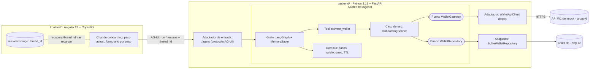
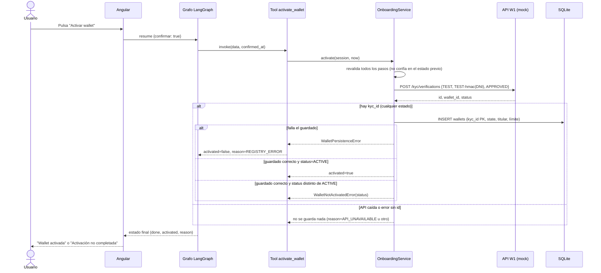

# AI Wallet — Onboarding conversacional de wallet de bajo monto

Registro y activación de una wallet en 5 pasos guiados, con validaciones bloqueantes en el servidor, verificación KYC contra la API W1 del mock del hackathon (grupo 6) y registro persistente de cada verificación.

## Índice

1. [Resumen del proyecto](#1-resumen-del-proyecto)
2. [Cobertura del reto](#2-cobertura-del-reto)
3. [Arquitectura y decisiones](#3-arquitectura-y-decisiones)
4. [Uso de IA](#4-uso-de-ia)
5. [Cómo ejecutar](#5-cómo-ejecutar)
6. [Evidencias y pruebas](#6-evidencias-y-pruebas)
7. [Trade-offs y aprendizajes](#7-trade-offs-y-aprendizajes)
8. [Equipo](#8-equipo)

---

## 1. Resumen del proyecto

### Qué resuelve

Un usuario que hace transferencias diarias de bajo monto desde el móvil (web) necesita dar de alta su wallet sin abandonar el proceso a mitad de camino. Antes de este trabajo no existía un flujo que guiara los pasos, mostrara en qué paso está el usuario ni bloqueara datos inválidos con mensajes que expliquen cómo corregirlos.

La solución es un chat asistente de onboarding conversacional que:

- guía al usuario por **5 pasos** (datos personales, contacto, DNI, monto máximo por operación y activación) mostrando siempre el paso actual;
- **bloquea el avance** si un dato falta o es inválido y explica qué corregir;
- **activa la wallet** solo si la verificación KYC de la API externa devuelve `ACTIVE`;
- **registra cada verificación** (con cualquier estado) en una base SQLite para poder saber quién activó su wallet, con qué verificación KYC y con qué límite;
- **expira la sesión** tras un tiempo de inactividad configurable (5 minutos por defecto) y reinicia desde el paso 1.

### Para quién

Usuario final (web) de una wallet de bajo monto. Usuario es una persona natural. El evaluador técnico es también usuario de este README: por eso el arranque se resume en dos terminales y un archivo `.env`.

### Reto

El reto (según la propuesta del cambio [`onboarding-wallet-bajo-monto`](openspec/changes/archive/2026-10-30-onboarding-wallet-bajo-monto/proposal.md)) es el flujo **W1 · Registro y activación** : crear la verificación KYC y la wallet, y llegar a una wallet activa sin que el usuario se pierda por el camino. Los contratos del mock están en [`contracts/bcp-wallet-mock-openapi.yaml`](openspec/changes/archive/2026-10-30-onboarding-wallet-bajo-monto/external-api/openapi.yaml).

### Valor de negocio

| Valor | Cómo lo aporta la solución | Estado |
|---|---|---|
| Menos abandono en el alta | Paso actual siempre visible, errores accionables, sesión que se retoma tras recargar (dentro del TTL) | Implementado. **El efecto sobre el abandono no se midió**: es una hipótesis de diseño |
| Control de riesgo | Monto máximo por operación definido por el usuario, con tope duro de 500 PEN validado en el servidor | Implementado y probado |
| Privacidad frente al tercero | El DNI real **no** viaja a la API: se envía `TEST-<HMAC-SHA256(DNI)>` | Implementado y probado |
| Trazabilidad | Tabla `wallets` con `kyc_id`, `wallet_id`, estado, titular y límite, también para verificaciones `PENDING` o `REJECTED` | Implementado y probado |
| Fallo seguro | Si la API cae o el registro no se puede guardar, la wallet **no** se activa y el usuario ve un mensaje final | Implementado y probado |

---

## 2. Cobertura del reto

### Requisitos de la spec

La spec viva es [`openspec/specs/wallet-onboarding/spec.md`](openspec/specs/wallet-onboarding/spec.md); los requisitos de persistencia están en el cambio [`persistir-wallet-activada-sqlite`](openspec/changes/persistir-wallet-activada-sqlite/specs/wallet-registry/spec.md).

| # | Requisito | Estado | Evidencia |
|---|---|---|---|
| 1 | Secuencia de 5 pasos visible, con paso actual | Implementado | [`onboarding-chat.html`](frontend/src/app/onboarding/onboarding-chat.html); prueba de dominio `test_onboarding_has_five_steps_and_starts_at_step_one`. Sin prueba automatizada de la UI |
| 2 | Datos obligatorios (nombre, apellidos, teléfono, email, DNI) | Implementado | `test_empty_required_field_blocks_step` y `test_empty_name_blocks_step_and_keeps_current_step` |
| 3 | DNI = exactamente 8 dígitos | Implementado | `test_dni_rejects_anything_but_exactly_eight_digits` (incluye `1234567`, `1234567A`, `" 12345678"`) |
| 4 | Monto máximo en PEN con 0 < monto ≤ 500 | Implementado | `test_max_amount_accepts_values_in_range` y `test_max_amount_rejects_values_outside_range` (0, −1, 501, `NaN`, `abc`, `True`, vacío) |
| 5 | Moneda por defecto PEN | Implementado | `test_amount_step_shows_pen_currency` |
| 6 | Mensajes accionables, sin avanzar | Implementado | `test_invalid_dni_loops_back_to_same_step_with_error`; los errores se muestran junto al campo |
| 7 | Sesión con expiración configurable (5 min) | Implementado | Tres pruebas de TTL en [`test_langgraph_onboarding.py`](backend/tests/adapters/test_langgraph_onboarding.py): valor por defecto, dentro del plazo y TTL configurado |
| 8 | Validación en el servidor aunque la UI no la haga | Implementado | `test_server_rejects_invalid_amount_sent_without_interface` |
| 9 | Activación solo si KYC devuelve `ACTIVE` | Implementado | `test_valid_flow_walks_all_steps_and_activates_wallet`, `test_rejected_activation_ends_without_wallet` |
| 10 | Documento `TEST-…` derivado, sin el DNI real | Implementado | `test_approved_verification_activates_wallet_and_sends_only_test_document`, `test_test_document_is_deterministic_and_hides_dni` |
| 11 | KYC no aprobada: se registra y no se activa | Implementado | `test_non_active_verification_is_saved_but_wallet_stays_inactive` (`PENDING` y `REJECTED`) |
| 12 | API no disponible: no se registra nada | Implementado | `test_unavailable_api_leaves_no_record` |
| 13 | Fallo al registrar: no se activa, mensaje final | Implementado | `test_persistence_failure_ends_without_activation_and_logs_only_identifiers` |
| 14 | Registro persistente con `kyc_id` único, `document_type = TEST`, ruta configurable | Implementado | [`test_sqlite_wallet_repository.py`](backend/tests/adapters/test_sqlite_wallet_repository.py) |
| 15 | "Acceso al punto de entrada de pagos" tras activar | **Parcial** | La UI solo muestra *"Wallet activada. Ya puedes realizar pagos."*. **No existe una pantalla ni ruta de pagos** (`routes = []`) |
| 16 | Validar formato de teléfono y email | **No implementado** | Hoy solo se exige que no estén vacíos. Era una pregunta abierta del diseño |

### Alcance del mock

El mock expone W1 a W6. Esta entrega cubre **solo W1**:

| Bloque del mock | Estado |
|---|---|
| W1 · Registro y activación (`POST /kyc/verifications`) | Implementado |
| W1 · `GET /kyc/verifications/{id}`, `POST …/decision`, `GET /wallets/{id}` | No usados |
| W2 · Pago a contacto, W3 · Pago QR, W4 · Idempotencia, W5 · Fallas y reversos, W6 · Conciliación | Fuera de alcance |

### Estado del proceso OpenSpec

| Cambio | Tareas | Estado |
|---|---|---|
| `onboarding-wallet-bajo-monto` | Todas marcadas `[x]` | Archivado el 2026-10-30 y sincronizado en `openspec/specs/` |
| `persistir-wallet-activada-sqlite` | Todas marcadas `[x]` | **Sin archivar y sin sincronizar**: `openspec/specs/` aún no contiene `wallet-registry` |

---

## 3. Arquitectura y decisiones

### Diagrama



### Flujo de activación (paso 5)



### Componentes

| Capa | Archivo | Responsabilidad |
|---|---|---|
| Dominio | [`backend/domain/onboarding.py`](backend/domain/onboarding.py) | Pasos, validación de campos, límite de 500 PEN, TTL. Sin dependencias de framework (hay una prueba que lo verifica: `test_core_does_not_import_framework_modules`) |
| Aplicación | [`backend/application/onboarding_service.py`](backend/application/onboarding_service.py) | Activar y registrar; decide cuándo hay registro y cuándo falla la activación |
| Puertos | [`wallet_gateway.py`](backend/ports/wallet_gateway.py), [`wallet_repository.py`](backend/ports/wallet_repository.py) | Contratos hacia la API externa y hacia el almacén |
| Adaptador de entrada | [`agui_endpoint.py`](backend/adapters/agui_endpoint.py) | FastAPI + AG-UI en `/agent`; CORS solo para `http://localhost:4200` |
| Orquestación | [`langgraph_onboarding.py`](backend/adapters/langgraph_onboarding.py) | Un nodo por paso, interrupciones para esperar al usuario, arista condicional que vuelve al paso con error |
| Tool | [`activation_tool.py`](backend/adapters/activation_tool.py) | `@tool` de LangChain que envuelve el caso de uso |
| Salida: API | [`wallet_api_client.py`](backend/adapters/wallet_api_client.py) | Cliente httpx, firma HMAC del documento |
| Salida: datos | [`sqlite_wallet_repository.py`](backend/adapters/sqlite_wallet_repository.py) | `sqlite3` de la biblioteca estándar, una conexión por guardado |
| Composición | [`backend/server.py`](backend/server.py) | Lee `.env` y arma las dependencias |
| Frontend | [`onboarding-chat.ts`](frontend/src/app/onboarding/onboarding-chat.ts) | Pinta el paso actual, envía respuestas con `resume`, deriva `activated` y `failed` del estado del grafo |

### Tabla `wallets`

| Columna | Descripción |
|---|---|
| `kyc_id` | Clave primaria: `id` de la verificación KYC |
| `wallet_id` | Wallet devuelta por la API |
| `state` | `ACTIVE`, `PENDING` o `REJECTED` |
| `document_number` | DNI real (en claro; ver [riesgos](#7-trade-offs-y-aprendizajes)) |
| `document_type` | `TEST` por defecto |
| `name`, `last_name`, `phone`, `email` | Datos del onboarding |
| `max_amount` | Monto máximo por operación, como texto decimal para no perder precisión |

### Decisiones y alternativas descartadas

| Decisión | Alternativa descartada | Motivo |
|---|---|---|
| Máquina de estados por pasos | Formulario libre validado al final | No permitiría paso actual visible ni bloqueo inmediato |
| LangGraph en el backend | LangGraph en el navegador | El runtime de agentes no corre de forma fiable allí |
| Validar y expirar en el servidor | Hacerlo solo en el cliente | El cliente puede manipularse |
| `thread_id` en `sessionStorage` | `localStorage` | La sesión debe terminar con la pestaña |
| Documento `TEST-<HMAC-SHA256(DNI)>` | SHA-256 plano o `TEST-<DNI>` | Solo hay 10⁸ DNI posibles, un hash plano se revierte por fuerza bruta; y el DNI real no debe salir hacia un tercero |
| Tool de LangChain **sin LLM** ni `ToolNode`, invocada por el nodo | Un modelo que decida cuándo llamar a la tool | El flujo es determinista; `ToolNode` solo aporta cuando un modelo emite la llamada |
| Persistir dentro del caso de uso, tras un puerto | Guardar desde el nodo del grafo | Mezclaría persistencia con orquestación y sería más difícil de probar |
| `sqlite3` estándar, una conexión por guardado | SQLAlchemy | Exceso para una tabla; `sqlite3` no permite compartir conexión entre hilos |
| Fallo de registro = activación fallida, sin reintento automático | Reintentar | Repetir la llamada crearía otra wallet en la API |
| Mensaje final sin botón de reintento | "Empezar de nuevo" con hilo nuevo | Añade un flujo de reinicio fuera de alcance |
| `MemorySaver` como checkpointer | Checkpointer persistente | Fuera de alcance; un `thread_id` perdido equivale a sesión expirada |

### Versiones

| Tecnología | Versión | Fuente |
|---|---|---|
| Python | 3.13 (`>=3.13,<3.14`); verificado con 3.13.15 | [`pyproject.toml`](backend/pyproject.toml) |
| langgraph / langgraph-checkpoint | 1.2.18 / 4.3.1 | `pyproject.toml` |
| ag-ui-langgraph | 0.0.47 | `pyproject.toml` |
| FastAPI / uvicorn / httpx | 0.162.0 / 0.54.0 / 0.28.1 | `pyproject.toml` |
| langchain-core | 1.7.3 | `pyproject.toml` |
| pytest | 9.2.0 | `pyproject.toml` |
| Node.js / npm | verificado con 26.9.0 / npm 11.19.1 | [`package.json`](frontend/package.json) |
| Angular | 22.2.4 (CLI 22.2.5) | `package.json` |
| TypeScript | 6.0.3 (fijada: el compilador de Angular 22 no acepta 7.x) | `package.json` |
| `@copilotkit/angular` / `@ag-ui/client` | 0.6.0 / 1.0.2 | `package.json` |
| Vitest | `^5.0.0` | `package.json` |

---

## 4. Uso de IA

### Qué es IA y qué no

**El producto en ejecución no usa ningún LLM.** El "agente" de onboarding es un grafo LangGraph determinista: cada paso es un nodo y la tool de activación la invoca el nodo directamente. Se eligió así porque el flujo es un proceso regulado (validar, verificar KYC, registrar) donde la imprevisibilidad de un modelo es un riesgo, no un beneficio. El componente `<copilot-chat>` está en la página, pero el backend no responde mensajes de texto libre con un modelo; **no verifiqué cómo se comporta ese cuadro de chat si el usuario escribe en él**.

**La IA sí se usó para construir el proyecto**, con un flujo guiado por especificaciones.

### Herramientas y artefactos

| Pieza | Dónde está | Para qué |
|---|---|---|
| GitHub Copilot en VS Code (modo agente) | `.github/` | Asistente de desarrollo |
| OpenSpec (esquema `spec-driven`) | [`openspec/config.yaml`](openspec/config.yaml) | Cada cambio pasa por propuesta, diseño, specs y tareas antes de tocar código |
| Agente personalizado `OpenSpec` | [`.github/agents/openspec.agent.md`](.github/agents/openspec.agent.md) | Gestiona cambios con el CLI de OpenSpec; herramientas limitadas a `execute`, `read`, `search`, `edit` |
| 6 skills | [`.github/skills/`](.github/skills) | `openspec-explore`, `-propose`, `-apply-change`, `-sync-specs`, `-update-change`, `-archive-change` |
| 6 prompts | [`.github/prompts/`](.github/prompts) | Comandos `/opsx-explore`, `/opsx-propose`, `/opsx-apply`, `/opsx-sync`, `/opsx-update`, `/opsx-archive` |
| Workflow para el agente de código de Copilot | [`.github/workflows/copilot-setup-steps.yml`](.github/workflows/copilot-setup-steps.yml) | Instala el CLI de OpenSpec en el entorno del agente |
| **MCP** | — | **Ninguno configurado en el repositorio.** El mock de la hackathon se consume por HTTP desde el adaptador, no como servidor MCP |

### Guardrails y por qué

| Guardrail | Qué evita | Evidencia |
|---|---|---|
| **Specs antes de código** y tareas con paso de verificación explícito ("verificar con…") | Que el asistente implemente algo que nadie pidió o dé por bueno algo sin comprobarlo | `tasks.md` de ambos cambios |
| Versiones **fijadas** y justificadas | Que el asistente instale versiones `latest` incompatibles (p. ej. TypeScript 7 con Angular 22) | [`pyproject.toml`](backend/pyproject.toml), [`package.json`](frontend/package.json), tabla de versiones del diseño |
| Validación **siempre en el servidor** | Que una petición manipulada se salte una regla | `test_server_rejects_invalid_amount_sent_without_interface` |
| Revalidar todos los pasos al activar | Confiar en un estado previo manipulado | `OnboardingSession.complete_data` |
| El DNI real no sale hacia la API | Filtrar datos personales a un tercero | Pruebas del cliente HTTP |
| Logs **sin datos personales**: solo `kyc_id` y `wallet_id` | Que un fallo exponga DNI o email en los logs | `test_persistence_failure_ends_without_activation_and_logs_only_identifiers`, `test_persistence_error_does_not_leak_personal_data` |
| Fallo seguro: sin registro no hay activación | Dar acceso a pagos a una wallet que no quedó registrada | Prueba de fallo de persistencia |
| Activación requiere confirmación explícita | Activar por un mensaje accidental | `test_activation_requires_confirmation` |
| CORS limitado a `http://localhost:4200` | Que cualquier origen llame al agente | `test_agui_cors_allows_angular_dev_server` |
| `.env` y `*.db` fuera de git | Subir la clave HMAC o datos personales | [`backend/.gitignore`](backend/.gitignore) |

---

## 5. Cómo ejecutar

### Requisitos

- **Python 3.13** (el proyecto exige `>=3.13,<3.14`).
- **Node.js 22.22.3+, 24.15+ o ≥ 26** (rango `engines` de `@angular/cli` 22 según el diseño; verificado con 26.9.0) y npm 11.
- Acceso a internet: el mock del grupo 6 está en `https://bcp-wallet-mock.yefri.workers.dev/groups/6`.
- Puertos libres: `8000` (backend) y `4200` (frontend).

### Variables de entorno

El archivo plantilla es [`backend/.env.example`](backend/.env.example). Solo `WALLET_DOCUMENT_KEY` es obligatoria; sin ella el backend no arranca (`RuntimeError`).

| Variable | Obligatoria | Por defecto | Descripción |
|---|---|---|---|
| `WALLET_DOCUMENT_KEY` | Sí | — | Clave HMAC del documento `TEST-…`. El mock acepta cualquier valor |
| `WALLET_API_BASE_URL` | No | `http://127.0.0.1:8787` | API W1. Para usar el mock en la nube, la URL del grupo 6 |
| `ONBOARDING_SESSION_TTL_SECONDS` | No | `300` | Inactividad máxima entre pasos |
| `WALLET_DB_PATH` | No | `wallet.db` | Archivo SQLite; una ruta relativa se resuelve respecto a `backend/` |

### Comandos (PowerShell)

**Terminal 1 — backend**

```powershell
cd backend
python -m venv .venv
.venv\Scripts\python.exe -m pip install -e ".[dev]"
Copy-Item .env.example .env          # el valor de WALLET_DOCUMENT_KEY puede quedarse como está para el mock
.venv\Scripts\python.exe -m uvicorn server:app --port 8000
```

**Terminal 2 — frontend**

```powershell
cd frontend
npm ci
npm start
```

En macOS/Linux: `python3 -m venv .venv`, `.venv/bin/python -m pip install -e ".[dev]"`, `cp .env.example .env` y `.venv/bin/python -m uvicorn server:app --port 8000`.

### URLs

| Qué | URL |
|---|---|
| Aplicación (onboarding) | http://localhost:4200 |
| Endpoint del agente (AG-UI) | http://localhost:8000/agent |
| Salud del agente | http://localhost:8000/agent/health |
| Salud del mock | https://bcp-wallet-mock.yefri.workers.dev/groups/6/health |

La URL del agente (`http://localhost:8000/agent`) está fija en [`app.config.ts`](frontend/src/app/app.config.ts).

### Datos de ejemplo

| Paso | Campo | Válido | Inválido (debe bloquear) |
|---|---|---|---|
| 1 | Nombre / Apellidos | `Ana` / `Perez` | vacío |
| 2 | Teléfono / Email | `999888777` / `ana@example.com` | vacío |
| 3 | DNI | `12345678` | `1234567`, `1234567A` |
| 4 | Monto máximo (PEN) | `300` | `0`, `501` |
| 5 | Activación | pulsar **Activar wallet** | — |

Para ver el registro guardado, con el backend detenido o en marcha:

```powershell
cd backend
.venv\Scripts\python.exe -c "import sqlite3; print(sqlite3.connect('wallet.db').execute('SELECT * FROM wallets').fetchall())"
```

### Ejecutar las pruebas

```powershell
cd backend ; .venv\Scripts\python.exe -m pytest -q      # backend
cd frontend ; npx ng build ; npx ng test --watch=false  # frontend
```

---

## 6. Evidencias y pruebas

### Resultados verificados (2026-10-30)

| Comprobación | Resultado |
|---|---|
| `pytest -q` en `backend/` | **94 passed**, 8 warnings, 2,25 s (los avisos son una deprecación de LangGraph dentro de `ag-ui-langgraph`) |
| `ng build` en `frontend/` | **Correcto** (con avisos de módulos CommonJS de CopilotKit) |
| `ng test --watch=false` en `frontend/` | **Falla: 2 de 2 pruebas.** Es la prueba generada por el CLI ([`app.spec.ts`](frontend/src/app/app.spec.ts)): espera el texto *"Hello, frontend"* y no declara el proveedor de CopilotKit (`NG0201: No provider found for COPILOT_KIT_CONFIG`). Está obsoleta; **no hay pruebas de la UI de onboarding** |
| Importar `server.py` con `.env` mínimo | La app compone y registra `/agent` y `/agent/health` |

### Happy path con la API real del mock

Ejecuté el caso de uso de activación con el cliente HTTP real contra el grupo 6 y un SQLite temporal (sin pasar por el navegador):

```text
activation: WalletActivation(activated=True, wallet_id='wallet_687409b29e954842', reason=None, kyc_id='kyc_66237c2e19e04dca', status='ACTIVE')
rows: [('kyc_66237c2e19e04dca', 'wallet_687409b29e954842', 'ACTIVE', '12345678', 'TEST', 'Ana', 'Perez', '999888777', 'ana@example.com', '300')]
```

Muestra que el DNI real queda en la base, que el tipo de documento es `TEST` y que la API devolvió `ACTIVE`. **No ejecuté el flujo completo en el navegador en esta revisión**; el equipo lo marcó como hecho en las tareas 8.1 (primer cambio) y 5.2 a 5.4 (segundo cambio).

### Casos cubiertos por las pruebas del backend

| Tipo | Caso | Prueba |
|---|---|---|
| Happy path | Recorre los 5 pasos y activa la wallet | `test_valid_flow_walks_all_steps_and_activates_wallet` |
| Happy path | Se guarda `ACTIVE` con kyc, wallet y monto | `test_activation_saves_record_through_the_tool` |
| Happy path | Flujo completo por HTTP/AG-UI con repositorio inyectado | `test_agui_full_flow_saves_record_in_injected_repository` |
| Borde | DNI de 7 dígitos, con letra, de 9, con espacio, vacío o `None` | `test_dni_rejects_anything_but_exactly_eight_digits` |
| Borde | Monto `0`, `-1`, `501`, `"NaN"`, `"abc"`, `True`, vacío | `test_max_amount_rejects_values_outside_range` |
| Borde | Respuesta tras 5 min de inactividad reinicia en el paso 1; antes de 5 min, no | pruebas de TTL |
| Borde | KYC `PENDING` o `REJECTED`: se guarda, no se activa | `test_non_active_verification_is_saved_but_wallet_stays_inactive` |
| Borde | API caída o error sin `id`: no se guarda nada | `test_unavailable_api_leaves_no_record`, `test_error_without_verification_body_has_no_kyc_id` |
| Borde | `kyc_id` duplicado: se rechaza y se conserva el original | `test_duplicate_kyc_id_is_rejected_and_original_record_is_kept` |
| Borde | Ruta de base no escribible | `test_unwritable_path_raises_persistence_error` |
| Guardrail | Fallo de guardado: no activa, `reason = REGISTRY_ERROR` | `test_persistence_failure_ends_without_activation_and_logs_only_identifiers` |
| Guardrail | Nada de DNI ni email en el log; el error de persistencia no filtra datos | misma prueba y `test_persistence_error_does_not_leak_personal_data` |
| Guardrail | El servidor rechaza un monto inválido enviado sin pasar por la UI | `test_server_rejects_invalid_amount_sent_without_interface` |
| Guardrail | El documento enviado es `TEST-<hash>` y no revela el DNI | `test_test_document_is_deterministic_and_hides_dni`, `test_test_document_depends_on_secret_key` |

### Logs

El backend tiene **una sola** sentencia de log, a propósito mínima: ante un fallo de registro emite solo identificadores.

```text
ERROR No se pudo registrar la verificación kyc_id=<id> wallet_id=<id>
```

Sirve para reconciliar a mano una wallet creada en la API que no quedó registrada, sin exponer datos personales. No hay logging estructurado, métricas ni trazas (ver [deuda](#7-trade-offs-y-aprendizajes)).

---

## 7. Trade-offs y aprendizajes

### Qué no se hizo

- **Pagos y el resto del mock (W2–W6).** No existe pantalla de pagos; tras activar solo se muestra un mensaje.
- **Validar formato de teléfono y email.** Solo se exige que no estén vacíos.
- **Probar estados `PENDING` / `REJECTED` desde la UI.** El cliente envía siempre el escenario `APPROVED`; esos caminos solo están cubiertos con dobles de prueba.
- **Un LLM en el flujo.** Decisión consciente (ver sección 4), no una carencia.
- **Autenticación.** El agente `/agent` no autentica.

### Deuda conocida

| Deuda | Detalle |
|---|---|
| Prueba del frontend rota | `app.spec.ts` es el esqueleto del CLI y falla; falta cubrir `onboarding-chat` |
| Sin prueba end-to-end automatizada | El recorrido en navegador se hizo a mano |
| Specs sin sincronizar | `openspec/specs/` no contiene `wallet-registry`, y el cambio de persistencia sigue sin archivar |
| URL del agente fija | `http://localhost:8000/agent` está escrita en el código del frontend, y el CORS solo admite `localhost:4200` |
| Observabilidad mínima | Una línea de log; sin métricas ni trazas |
| Dependencias sin auditar | `npm ci` sugiere ejecutar `npm audit`; no lo revisé |
| Dos implementaciones de backend | La rama `rol-backend` contiene un backend alternativo en Quarkus 3.15.3 / Java 21 que **no está integrado** con este frontend (que habla AG-UI con el backend Python). Debe decidirse cuál es la entrega |
| Frontend duplicado en otra rama | La rama `hack/frontend` trae además una carpeta `frontend-chat/` |

### Riesgos

| Riesgo | Efecto | Mitigación actual |
|---|---|---|
| **Datos personales en claro** (DNI, nombre, teléfono, email) en `wallet.db` | Exposición si se filtra el archivo | El `.db` está fuera de git y su ruta es configurable. **Sin cifrado ni política de retención** |
| `MemorySaver` en memoria | Reiniciar el backend pierde las sesiones en curso; no sirve con varias instancias | Un `thread_id` desconocido se trata como sesión expirada y vuelve al paso 1 |
| La API crea la wallet pero el guardado local falla | Wallet huérfana en la API y usuario con error | Log con `kyc_id` y `wallet_id` para reconciliar a mano; sin reintento automático (crearía otra wallet) |
| Altas repetidas con el mismo DNI | Dos wallets y dos registros | No se bloquea por DNI; la clave primaria es el `kyc_id`, igual que el mock, que "no evita altas repetidas" |
| `database is locked` bajo concurrencia | Fallo de registro | Una conexión por operación con `timeout` de 15 s; el error cuenta como fallo de persistencia |

### Siguiente iteración

1. Reparar `app.spec.ts` y añadir pruebas del componente `onboarding-chat` (incluido el mensaje de activación no completada).
2. Añadir una prueba end-to-end con Playwright del recorrido completo.
3. Cifrar los datos personales en reposo y definir la retención.
4. Validar el formato de teléfono y email.
5. Sincronizar `openspec/specs/` y archivar el cambio de persistencia.
6. Decidir y unificar el backend (Python o Quarkus) y eliminar el sobrante.
7. Permitir configurar la URL del agente y los orígenes CORS por entorno.
8. Construir el punto de entrada de pagos (W2) sobre la wallet activa.

### Aprendizajes

- **Una spec con escenarios de error aterriza el diseño.** Los casos "API caída", "estado no activo" y "falla el registro" definieron las reglas de consistencia (cuándo se guarda, cuándo se activa) antes de escribir código.
- **Fallar cerrado es más barato que reconciliar.** Tratar el fallo de registro como activación fallida evita una wallet visible como activa que no existe en nuestros datos.
- **Fijar versiones evita sorpresas del asistente.** El `latest` de TypeScript es incompatible con Angular 22; dejarlo escrito en el diseño lo previno.
- **El entorno también es parte de la entrega.** Al verificar para este README, la instalación de `node_modules` que había no coincidía con `package.json` y el build fallaba hasta repetir `npm ci`. Por eso el README indica `npm ci` y no `npm install`.

---

## 8. Equipo

Los roles son los del equipo. La columna "Ámbito" indica qué partes del repositorio corresponden a cada rol.

| Integrante | Rol | Ámbito en el proyecto |
|---|---|---|
| Alonso Villegas | Arquitecto | Arquitectura hexagonal y sus decisiones |
| Karen Gutiérrez | Testing | Estrategia y suite de pruebas|
| Antonio Ramos | Chapter | Prácticas y estándares compartidos del equipo: flujo OpenSpec, versiones fijadas y convenciones de `.github/` |
| Pedro Ramírez | Frontend | `frontend/`: chat de onboarding en Angular con CopilotKit y mensajes al usuario |
| Jackelyn Callan | Backend | `backend/`: dominio, caso de uso, cliente de la API W1, endpoint AG-UI y persistencia SQLite |
| Neil Quispe | Modelador de datos | Modelo de datos: tabla `wallets`, claves, tipos |
| Alex Marena | Seguridad de aplicación | Guardrails de seguridad, logs sin datos personales, CORS y riesgos de datos en claro |

---
